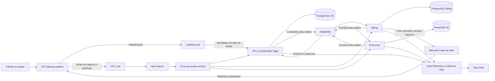

# Arquitetura final e Saga orquestrada

## Divisão e persistência

OS é dono de atendimento, clientes, veículos, usuários, catálogo, estoque e histórico global. Billing é dono de proposta imutável, decisão, pagamentos, operações e notificações. Execução é dona do trabalho técnico, diagnóstico, itens autorizados, progresso e versão. São três deploys independentes com contratos HTTP/mensagens próprios. Auth e plataforma são apoio; não são participantes adicionais da Saga.

OS e Billing têm bancos lógicos e usuários exclusivos na mesma instância PostgreSQL/RDS. Isso oferece separação de ownership/permissões, não isolamento físico ou independência do recurso RDS. Execução usa Mongo dedicado ao domínio técnico, replica set rs0 para transações locais. Nenhum serviço consulta o banco de outro participante; a identidade é consultada por HTTP privado. A Lambda não possui conexão ao banco de OS.

Java 21/Spring Boot reaproveitam o domínio e os testes existentes. PostgreSQL protege relações e consistência comercial; Mongo acomoda o agregado e versões do trabalho técnico e atende à combinação SQL/NoSQL. RabbitMQ permite integração assíncrona e reentrega; a opção exige idempotência e operação do broker. O cluster EKS e os componentes de apoio são compartilhados para adequação ao Academy.

## Por que orquestração

OS já conhece o ciclo global do atendimento. A Saga persistida concentra próximos comandos, prazos, histórico e retomada. Billing mantém a decisão financeira e Execução a decisão técnica. A alternativa coreografada distribuiria a decisão global por eventos entre participantes, aumentando a dificuldade de explicar e recuperar esse ciclo. O custo escolhido é a dependência do coordenador para avançar; estado persistido, outbox e scheduler permitem retomada.

Negócio, inbox e próximo comando/outbox são gravados em uma transação local. O ACK vem depois do commit. Publisher confirms e leases não eliminam duplicatas de rede: inbox, versão e chaves de negócio protegem o efeito. Não há promessa de entrega exactly-once.

## Fluxo de sucesso

1. OS valida o atendimento e grava OS/tentativa/outbox. Execução admite o diagnóstico uma vez por contexto.
2. Eventos técnicos levam OS à composição. OS reserva estoque e Billing recebe snapshot imutável com centavos e quantidades decimais.
3. Rejeição preserva diagnóstico, libera a reserva e permite outra versão de proposta. Aprovação consome a reserva sem outra baixa no saldo.
4. Billing persiste intenção/operação antes da chamada externa, com chave idempotente estável e lease. O worker chama Mercado Pago fora da transação SQL.
5. Webhook autentica e agenda reconciliação. A confirmação vem da consulta do recurso no provedor, conferindo vendedor, aplicação, referência, tipo, valor e moeda. Corpo de webhook não libera o reparo sozinho.
6. OS projeta confirmação vigente e solicita autorização técnica. Execução exige If-Match e conserva os itens autorizados. Eventos de conclusão levam OS à finalização e entrega.

## Compensações e falhas

| Momento | Ação e condição |
|---|---|
| Proposta rejeitada | Libera reserva e permite recomposição; proposta antiga não volta a aprovada |
| Cancelamento sem cobrança | Confirma cancelamento técnico e encerramento do orçamento; só então reverte estoque |
| Cobrança pendente | Cancela/reconcilia no provedor antes da confirmação financeira local necessária |
| Pagamento confirmado, reparo não iniciado | Confirma cancelamento técnico, estorno real e devolução única do estoque |
| Reparo iniciado | Efeito físico não é desfeito por rollback; recusa impede estorno/reposição automáticos fictícios e exige tratamento de negócio |
| Timeout/retry esgotado ou recurso divergente | Estado/histórico persistidos; compensação ou recuperação administrativa, preservando identidades/chaves |

Cancelamento/estorno solicitado não equivale a confirmado. Um evento financeiro antigo não reabre a tentativa compensada. Movimento de reversão referencia o consumo original e não apaga o histórico. [Resultados executados](README.md) incluem entrega, orçamento cancelado, estorno e timeout com 19 retries.

## Operação e limites do Academy

LabRole e credenciais temporárias existentes são preservadas; não se cria IAM/OIDC para contornar o lab. States de EKS/RDS/plataforma permanecem separados. Mongo/Rabbit têm uma réplica com PVC, sem alegação de HA, backup ou restauração comprovada. SMTP fica desativado. O runtime foi validado na sessão; amanhã é preciso iniciar o lab e renovar AWS para novos workflows.

O ambiente atual usou contas Mercado Pago de teste, sem dinheiro real. O simulador do painel respondeu 200; os pagamentos/estorno foram comprovados consultando as orders ligadas às OS, não pela simulação. O callback individual de cada compra não foi inspecionado separadamente. Os limites do trace estão em [observabilidade](OBSERVABILIDADE.md).
