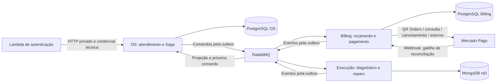

# Arquitetura implementada e decisões operacionais

Este arquivo descreve a versão atual do código; não é prova de deploy ou de pagamento externo.

Os três serviços são projetos independentes, com configuração e pipeline próprios. A Lambda e a plataforma compartilhada são projetos de apoio; não são um quarto participante da Saga. As credenciais são separadas; os SQLs compartilham a instância RDS no Academy com bancos lógicos distintos. A aplicação nunca consulta a persistência de outro participante.

OS preserva clientes, veículos, usuários, catálogo, estoque e histórico. Billing possui o snapshot imutável da proposta, decisão, intenção financeira, operações externas e auditoria. Execução possui diagnóstico, mecânico, itens autorizados e progresso técnico. Os objetos legados puros que ainda existem em OS são compatibilidade de modelo/testes; não há tabela, repository ou controller de orçamento ativo em OS.

## Caminho de sucesso

1. OS valida os dados e grava atendimento, tentativa, estado e outbox juntos.
2. Execução cria trabalho uma vez por OS/tentativa; publica admissão, início e conclusão do diagnóstico.
3. OS compõe e reserva estoque. A proposta fixa quantidade decimal, preço unitário e total em centavos.
4. Billing grava proposta e notificação; a decisão é autenticada e vinculada ao cliente/versão.
5. Aprovação registra consumo da reserva sem descontar novamente o saldo. OS persiste pagamentoId e solicita cobrança.
6. Billing grava intenção/operação antes de chamar Mercado Pago. O worker opera fora da transação de banco, com chave estável e lease por pagamento.
7. O resultado é consultado no provedor e confrontado com conta, referência, recurso, moeda e valor. Webhook só agenda reconciliação, nunca confirma o pagamento por seu corpo.
8. OS aceita a versão financeira vigente e solicita enfileiramento. Execução congela os itens e exige versão esperada em cada alteração técnica.
9. Eventos técnicos atualizam OS, que termina com finalização e entrega autorizada.

## Identidades e estados

`sagaId` é a coordenação do atendimento; `attemptId` identifica sua tentativa técnica. Rejeição comercial conserva o diagnóstico, limpa a composição corrente e gera outro `orcamentoId`/`orcamentoVersao`. `pagamentoId` também é a identidade persistida da criação externa. Cancelamento/estorno usam operações próprias determinísticas e conservam suas chaves por retry.

Estados globais principais: RECEBIDO, EM_DIAGNOSTICO, EM_COMPOSICAO, AGUARDANDO_ORCAMENTO, AGUARDANDO_APROVACAO, AGUARDANDO_PAGAMENTO, AGUARDANDO_ADMISSAO_REPARO, AGUARDANDO_EXECUCAO, EM_EXECUCAO, FINALIZADA, ENTREGUE. Compensação usa COMPENSANDO, COMPENSADA e RECUPERACAO_PENDENTE. A situação de cancelamento físico e financeiro fica persistida separadamente.

OS controla a versão financeira por pagamento: confirmação antiga não pode reabrir uma compensação depois do estorno. A projeção técnica também usa versão; conclusão pode chegar antes do evento de início e ainda percorrer transições válidas.

## Garantias e limites

- Negócio, inbox e próximo comando/outbox são atômicos no banco do participante. ACK vem depois do commit.
- Publisher confirms e lease não eliminam duplicatas de rede; inbox e chaves de negócio evitam duplicação dos efeitos.
- Timeout de criação não significa cobrança inexistente. Repetição da criação usa a mesma chave persistida; recurso conhecido é consultado antes de mutação. Retry esgotado ou recurso divergente exige revisão.
- Cancelamento anterior à criação deixa marca persistida. Comando atrasado não recria tentativa técnica ou financeira cancelada.
- A compensação confirma o cancelamento do trabalho antes da ação financeira. Estorno aceito ainda não é estorno confirmado.
- Reversão do estoque se vincula ao movimento original e não apaga reserva/consumo anteriores. Só é feita depois das confirmações exigidas.
- Reparo já iniciado não é desfeito por rollback. Recusa de cancelamento impede reposição fictícia e estorno automático. Progresso técnico pago que continua/conclui pode convergir com a projeção global.
- Persistência acadêmica de apoio tem uma réplica por banco/broker, com PVC. Isso não oferece alta disponibilidade; recuperação e backup continuam sujeitos a configuração e prova reais.

## Contrato Mercado Pago e pendência externa

O adapter prepara QR dinâmico com Orders, criação idempotente, consulta, cancelamento e estorno. Preserva `qr_data` para o consumidor da API. Credenciais, loja/caixa e webhook precisam ser configurados na conta de teste. O código foi validado com servidor HTTP local; não foi apresentada uma cobrança real de teste como realizada.

Fontes oficiais: [processamento QR/Orders](https://www.mercadopago.com.br/developers/pt/docs/qr-code/payment-processing), [referência de criação](https://www.mercadopago.com.br/developers/en/reference/in-person-payments/qr-code/orders/create-order/post), [referência de cancelamento](https://www.mercadopago.com.br/developers/en/reference/in-person-payments/qr-code/orders/cancel-order/post), [notificações](https://www.mercadopago.com.br/developers/pt/docs/qr-code/notifications), [verificador oficial do SDK](https://github.com/mercadopago/sdk-java/blob/master/src/main/java/com/mercadopago/webhook/WebhookSignatureValidator.java).

Há divergência entre orientações de QR/notificações e comentários do SDK sobre assinatura. A opção implementada é falhar fechado: exigir HMAC válido, comparar o ID assinado e buscar o recurso. A assinatura efetivamente enviada pelo produto/conta escolhidos ainda deve ser comprovada no teste externo; não desabilitar a conferência financeira para contornar essa pendência.

Atualização Academy 09/11: a implantação padrão reutiliza bancos lógicos no RDS existente e uma entrada NLB adicional; consultar ACADEMY.md e ESTADO-ACADEMY.md. Não há dependência nova de ingress-nginx nem IAM role criada.
