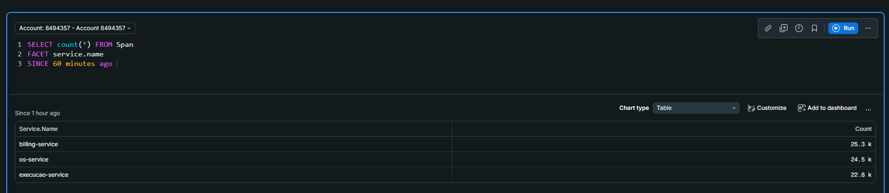
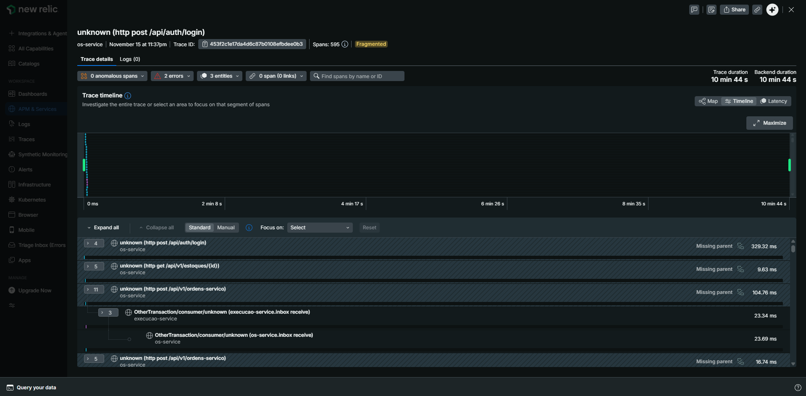
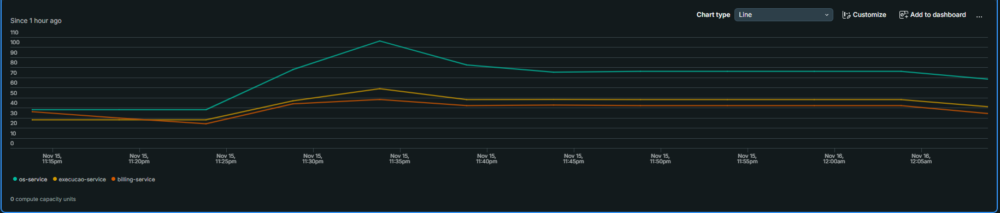

# Observabilidade comprovada e limites

Conta New Relic 8494357. Dados e capturas fornecidos pelo solicitante em 15/11/2026 BRT foram registrados sem credenciais.

| Prova | Resultado |
|---|---|
| Spans | Os três serviços enviaram spans; contexto 453f2c1e17da4d6c87b0108efbdee0b3 tem 431 spans OS, 84 Billing e 80 Execução |
| Mensageria | Timeline mostra criação da OS com consumidores aninhados Execução inbox receive e OS inbox receive nesse trecho |
| Autorização | Dois spans de erro na mesma chamada de diagnóstico: cliente 403 esperado, depois mecânico 200; cruzado com relatório de teste |
| Logs | Billing 173, OS 121, Execução 68 e Auth 13 na janela consultada; unknownGroup não identifica origem/severidade |
| Métricas | Descobertos 126 nomes; gráfico HTTP tem as três séries, com taxa de requests/min em intervalos de 5 minutos |

Os JSON correspondentes em evidencias/observabilidade registram janela, consulta e interpretação. A taxa inclui probes/saúde; não é volume de OS, benchmark de carga ou SLO. O trace de 595 spans abrange várias requests com contexto reutilizado pela collection: 10 min 44 s não são latência de uma única chamada.

O trace aparece Fragmented e há pais ausentes em entradas HTTP. Spans de cliente não exportados podem explicar esses trechos; não comprovamos a causa de toda fragmentação. A tela mostrou Logs (0): a ingestão global foi comprovada depois, mas o vínculo desses logs ao trace específico continua sem demonstração. A captura comprova o trecho OS/Execução observado; não substitui inspeção de cada ligação ou de todos os spans Billing.

Para a gravação, mostrar os dados e explicar essas limitações sem tratar correlação de IDs como prova de todas as relações. SMTP, alertas provocados nesta sessão e backup/restauração não foram comprovados pelos gráficos. O PR antigo #16 do repositório de arquitetura trata state de assets New Relic e permanece separado desta consolidação; não foi aplicado nenhum Terraform de dashboards nesta etapa.
